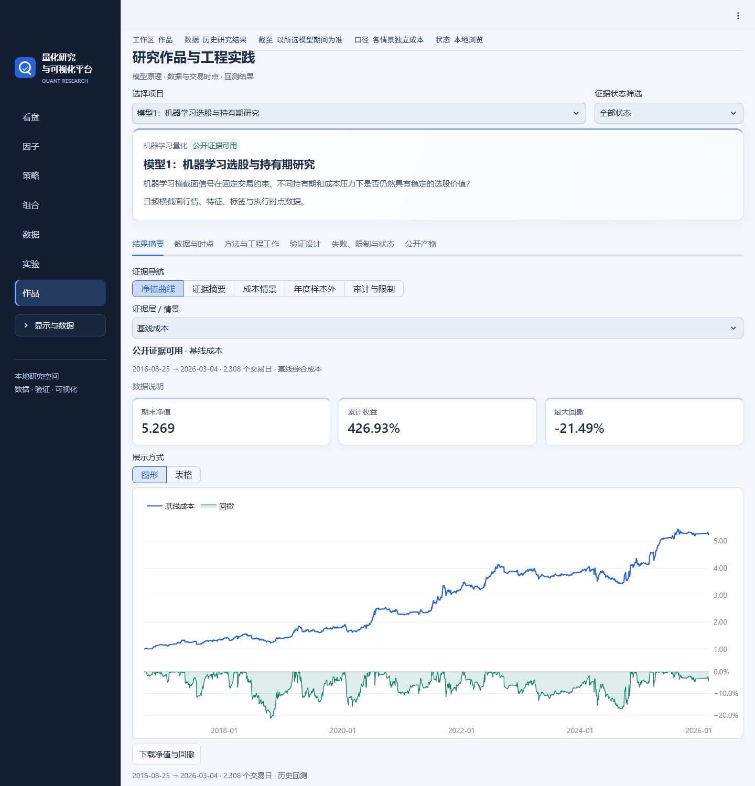

# 量化研究与可视化平台

面向个人的本地量化工作台，从日线行情出发，做因子诊断、策略回测和组合分析。研究结果可以保存、对比和复算。

[快速开始](#快速开始) · [界面预览](#界面预览) · [数据获取](docs/data.md) · [技术文档](#技术文档)


*看盘工作区，使用仓库内置的合成行情。*

## 快速开始

需要 Python **3.12 或 3.13**。下面的命令安装本文截图对应的版本。内置样例无需行情账号。

```sh
git clone --branch codex/platform-v2-m2 https://github.com/Old-Doggy/quant-research-platform.git
cd quant-research-platform
python -m venv .venv
```

PowerShell 使用 `.\.venv\Scripts\python.exe`，macOS / Linux 使用 `./.venv/bin/python`，替换下面命令中的 `python`。

```sh
python -m pip install --upgrade "pip>=26.2"
python -m pip install -r requirements.txt
python -m streamlit run streamlit_app.py --server.address 127.0.0.1
```

打开 [127.0.0.1:8501](http://127.0.0.1:8501/)。在左侧进入 **策略 → 运行研究**，用默认模板生成净值和回撤，再到 **买卖事件** 查看信号和模拟成交。已完成的研究可在 **实验** 中查看。

## 界面预览

| 工作区 | 可以查看或操作 |
| --- | --- |
| 看盘 | 日、周、月 K 线，指标、成交量和研究事件 |
| 因子 | Rank IC、截面明细及分组收益 |
| 策略 | 策略与基准净值、回撤、买卖事件和换手成本 |
| 组合 | 权重、现金、调仓、持仓和收益分解 |
| 数据 | 行情更新、快照覆盖、财务观察及文件导入 |
| 实验 | 已保存结果、对比、归档和复算 |
| 作品 | 七个历史研究案例与 11 条授权公开的汇总净值 |

<details>
<summary>策略回测与历史作品截图</summary>

**策略研究** · 合成样例，净值与回撤共用日期，各用独立纵轴。


**历史作品** · 已公开的回测汇总，展示原区间及成本情景。



</details>

## 数据

可以直接用内置样例，也可以导入自己的 CSV、Excel 或 Parquet。新版提供有限范围的沪深 A 股日线更新和财务观察，免费日线快照用于看盘和筛选。用于真实回测前，需核对公司行为、交易状态和历史数据的可用时点。[数据格式、来源与示例](docs/data.md)

行情、导入文件和研究归档存放在本机。仓库中的数据是合成样例与授权公开的历史汇总。作品保留各模型的样本区间、成本和验收状态。

## 技术文档

| 主题 | 文档 |
| --- | --- |
| 操作 | [使用指南](docs/usage.md) · [数据获取](docs/data.md) |
| 实现 | [项目架构](docs/architecture.md) · [研究计算口径](docs/methodology.md) |
| 维护 | [更新与运行](docs/operations-v2.md) · [备份恢复](docs/recovery-runbook.md) |
| 版本 | [当前状态](docs/status-v2.md) · [验收记录](docs/release-engineering-audit.md) |

开发环境安装 `requirements-dev.txt` 后运行 `python -m pytest`。GitHub Actions 覆盖 Windows、Linux 与 Python 3.12、3.13。[测试记录](docs/verification.md)

项目采用 [MIT](LICENSE) 许可证。Lightweight Charts 和其他第三方资源遵循各自条款。[第三方资源](docs/third-party.md)
