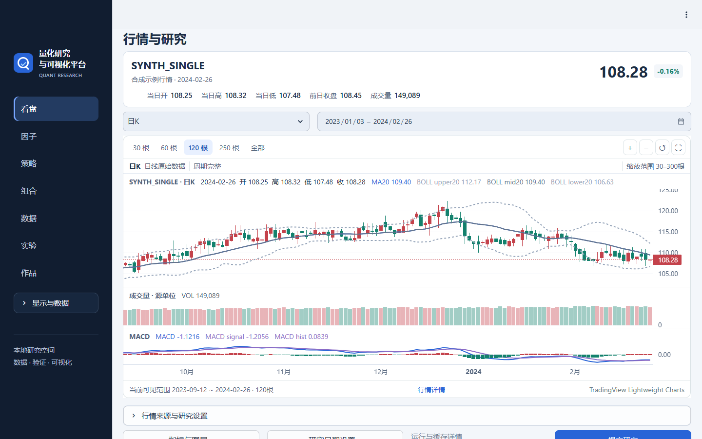
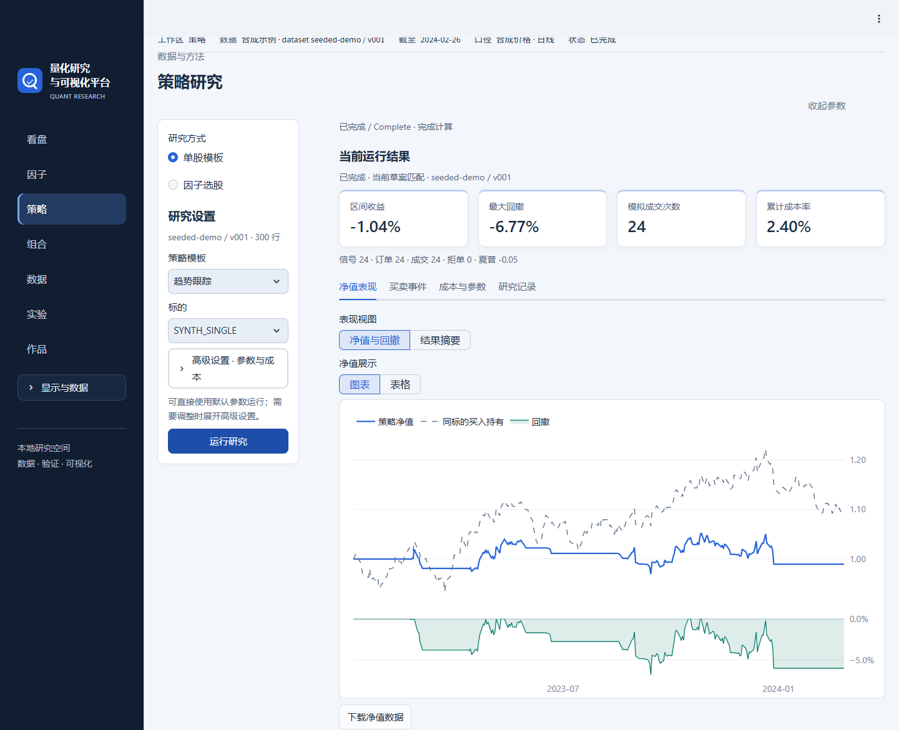

# 量化研究与可视化平台

面向个人的本地量化工作台，从日线行情出发，做因子诊断、策略回测和组合分析。研究结果可以保存、对比和复算。

[快速开始](#快速开始) · [新版使用指南](https://github.com/Old-Doggy/quant-research-platform/blob/codex/platform-v2-m2/docs/usage.md) · [数据获取](https://github.com/Old-Doggy/quant-research-platform/blob/codex/platform-v2-m2/docs/data.md) · [技术文档](#技术文档)



*新版看盘工作区，使用内置合成行情。本文的截图和启动命令均对应 `codex/platform-v2-m2`。*

## 快速开始

需要 Python **3.12 或 3.13**。内置样例无需行情账号。

```sh
git clone --branch codex/platform-v2-m2 https://github.com/Old-Doggy/quant-research-platform.git
cd quant-research-platform
python -m venv .venv
```

PowerShell 使用 `.\.venv\Scripts\python.exe`，macOS / Linux 使用 `./.venv/bin/python`，替换下面命令中的 `python`。

```sh
python -m pip install --upgrade "pip>=26.2"
python -m pip install -r requirements.txt
python -m streamlit run streamlit_app.py --server.address 127.0.0.1
```

打开 [127.0.0.1:8501](http://127.0.0.1:8501/)。进入 **策略 → 运行研究**，用默认模板查看净值、回撤和模拟成交。完成后可在 **实验** 中查看研究记录。

## 界面预览

| 工作区 | 可以查看或操作 |
| --- | --- |
| 看盘 | 日、周、月 K 线，技术指标、成交量和研究事件 |
| 因子 | Rank IC、截面明细与分组收益 |
| 策略 | 策略与基准净值、回撤、买卖事件和换手成本 |
| 组合 | 权重、现金、调仓、持仓和收益分解 |
| 数据 | 行情更新、快照覆盖、财务观察及文件导入 |
| 实验 | 已保存结果、对比、归档和复算 |
| 作品 | 七个历史研究案例与 11 条授权公开的汇总净值 |

<details>
<summary>策略回测与历史作品截图</summary>

**策略研究** · 合成行情，净值与回撤共用日期，各用独立纵轴。



**历史作品** · 已公开的回测汇总，展示原区间及成本情景。


</details>

## 数据

仓库附带合成样例和授权公开的研究汇总。自己的行情可通过 CSV、Excel 或 Parquet 导入，输入文件和实验归档存放在本机。新版提供有限范围的沪深 A 股日线更新，免费快照用于看盘和筛选。真实回测还需核对公司行为、交易状态及历史数据可用时点。[数据格式、来源与示例](https://github.com/Old-Doggy/quant-research-platform/blob/codex/platform-v2-m2/docs/data.md)

## 技术文档

| 主题 | 新版文档 |
| --- | --- |
| 操作 | [使用指南](https://github.com/Old-Doggy/quant-research-platform/blob/codex/platform-v2-m2/docs/usage.md) · [数据获取](https://github.com/Old-Doggy/quant-research-platform/blob/codex/platform-v2-m2/docs/data.md) |
| 实现 | [项目架构](https://github.com/Old-Doggy/quant-research-platform/blob/codex/platform-v2-m2/docs/architecture.md) · [计算口径](https://github.com/Old-Doggy/quant-research-platform/blob/codex/platform-v2-m2/docs/methodology.md) |
| 维护 | [更新与运行](https://github.com/Old-Doggy/quant-research-platform/blob/codex/platform-v2-m2/docs/operations-v2.md) · [备份恢复](https://github.com/Old-Doggy/quant-research-platform/blob/codex/platform-v2-m2/docs/recovery-runbook.md) |
| 版本 | [交付状态](https://github.com/Old-Doggy/quant-research-platform/blob/codex/platform-v2-m2/docs/status-v2.md) · [发布前审查](https://github.com/Old-Doggy/quant-research-platform/blob/codex/platform-v2-m2/docs/release-engineering-audit.md) |

默认分支保留已发布的源码，新版应用位于 [codex/platform-v2-m2](https://github.com/Old-Doggy/quant-research-platform/tree/codex/platform-v2-m2)。

代码和授权研究汇总采用 [MIT](LICENSE) 许可证。[第三方资源](docs/third-party.md)
